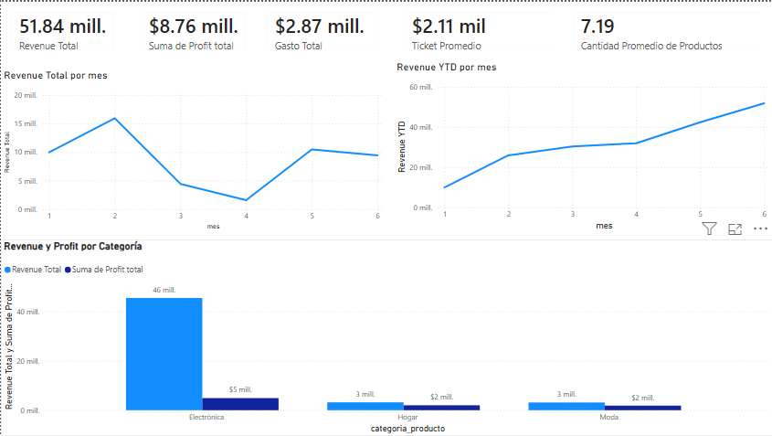

# Ventas, rentabilidad y marketing (Power BI / DAX)

Proyecto final de la certificación Data Analyst de TripleTen (2026).

## Qué hace
Dashboard ejecutivo que integra datos de pedidos, catálogo de productos, marketing y fechas para evaluar el desempeño comercial.

## Indicadores principales (KPIs)
- Revenue total: 51.84 millones
- Profit total: 8.76 millones
- Gasto total: 2.87 millones
- Ticket promedio: 2.11 mil
- Cantidad promedio de productos por pedido: 7.19

## Análisis incluidos
- Revenue total por mes
- Revenue acumulado (YTD) por mes
- Revenue y profit por categoría de producto (Electrónica, Hogar, Moda)
- Vistas de detalle por producto y categoría con filtros interactivos

## Hallazgo
La categoría Electrónica concentra la mayor parte del revenue y del profit frente a Hogar y Moda.

## Herramientas
Power BI Desktop, DAX, modelado de datos.

## Archivos
- `Proyecto_Final_MauricioCastroarenas.pbix`: reporte completo (se abre con Power BI Desktop)
- `dashboard-ventas.png`: captura del dashboard

## Autor
Mauricio Castroarenas · [LinkedIn](https://www.linkedin.com/in/mauriciocastroarenas/)
